## Selected projects

Systems programming, local AI, infrastructure automation and application development.

| Project | What it explores | Stack / status |
| --- | --- | --- |
| [AITalkingAgent](https://github.com/Rowolfs/AITalkingAgent) | Telegram voice conversations powered by local speech recognition, language-model inference and speech synthesis. | Python · Whisper · Ollama · Piper **Prototype** |
| [backyard-client-config-proxy-golang](https://github.com/Rowolfs/backyard-client-config-proxy-golang) | Reverse proxy that transforms Remnawave subscription responses using user and host metadata. | Go · HTTP · Docker **Microservice** |
| [KolosLinux](https://github.com/Rowolfs/KolosLinux) | Linux-side AHardwareBuffer/dma-buf import and buffer lifecycle experiments on ARM64 Debian with Qualcomm Turnip. | C++ · Vulkan · Linux **Prototype** |
| [SchoolAdmin](https://github.com/Rowolfs/SchoolAdmin) | School administration application with separate frontend and backend services, data modeling and database migrations. | TypeScript · Next.js · Prisma · PostgreSQL **Coursework** |
| [wolmos/wolrus-monitoring-ansible](https://github.com/wolmos/wolrus-monitoring-ansible) | Centralized Linux monitoring with reusable Ansible roles, metrics, logs and Telegram alerts. | Ansible · Docker · Grafana · Prometheus · Loki **Infrastructure** |
| [FocusSimaGame](https://github.com/Rowolfs/FocusSimaGame) | A prebuilt Unity game with a custom portrait-oriented browser player and loading interface. | Unity · WebGL **Browser build** |

[Browse all repositories →](https://github.com/Rowolfs?tab=repositories)
